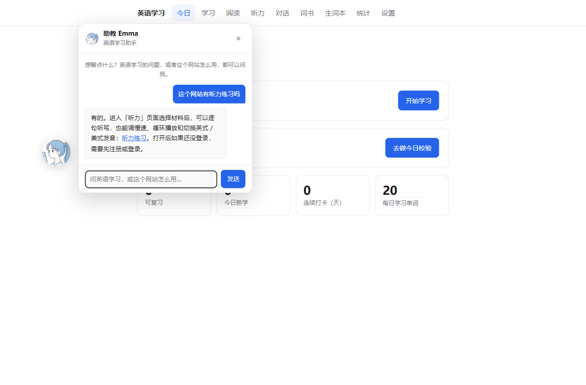
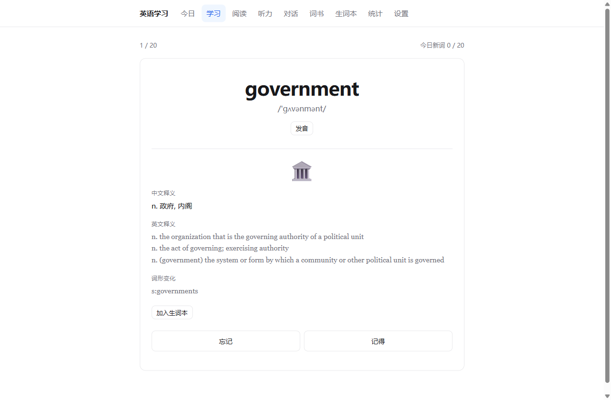
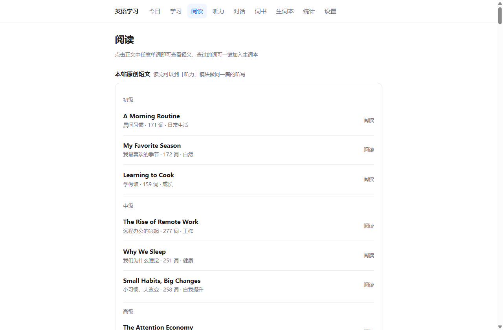

# 英语学习平台

自托管的英语学习网站：背单词、阅读、听力、AI 对话。后端零第三方依赖，克隆下来就能跑，数据全部存在自己的服务器上。

## 功能

**单词**

- 7 本词书：四级、六级、考研、雅思、托福、GRE、牛津核心 3000，共 15,002 词条
- 按词频推送新词，SM-2 算法安排复习时间
- 每日校验：只考当天新学的词，看中文拼英文 / 看英文选中文，错题可一键进生词本
- 复习队列：考今天之前学过的词，已学词超出上限时按学习时间加权抽取
- 生词本与全文检索

**阅读**

- 分级短文，点正文任意单词即可查释义
- 自动还原词形——点 `went` 查到的是 `go`
- 查词弹窗里可直接加入生词本

**听力**

- 逐句听写，提交后逐词比对，漏写与错词分别标出
- 可调语速、循环播放、英美音切换

**AI 对话**

- 六个生活场景（面试、点餐、值机、会议、看医生、闲聊），AI 扮演角色
- 每轮回复后标出语法错误并给出改正
- 支持浏览器语音输入

**学习助教**

- 首页的悬浮球，可拖动，点击展开对话面板
- 回答英语学习与本站使用的问题，涉及操作时附上对应页面的跳转链接
- 由 Dify 托管的 Agent 驱动

## 截图

| 首页与学习助教 | 学习卡片 | 阅读 |
| --- | --- | --- |
|  |  |  |

## 快速开始

需要 Node.js 22.5 或更高版本（依赖内置的 `node:sqlite`）。

```bash
# 1. 下载开源词库（约 63MB）
curl -L -o data/ecdict.csv \
  "https://ghfast.top/https://raw.githubusercontent.com/skywind3000/ECDICT/master/ecdict.csv"

# 2. 导入词书
npm run import:ecdict

# 3. 启动
npm start
```

打开 <http://localhost:3000>，注册账号后选择一本词书即可开始。

## 配置

复制 `.env.example` 为 `.env` 后按需填写：

| 变量 | 用途 |
| --- | --- |
| `PORT` | 服务端口，默认 3000 |
| `DB_PATH` | SQLite 数据库路径 |
| `ANTHROPIC_BASE_URL` / `ANTHROPIC_AUTH_TOKEN` | AI 对话的模型端点（Anthropic Messages API 格式） |
| `DIFY_BASE_URL` / `DIFY_API_KEY` | 学习助教所用的 Dify 应用 |

`.env` 已在 `.gitignore` 中，不会被提交。

## 部署

项目已容器化，可部署到任何支持 Docker 的平台（当前运行在 Railway）。

```bash
npm run build:seed   # 生成部署用的种子库
railway up -y
```

`build:seed` 会把本地开发库复制一份并**清空全部用户数据**，另存为 `data/seed.db`，镜像只使用后者。

**必须把持久卷挂载到 `/data`**，否则每次重新部署数据都会清零。

## 技术栈

| 层 | 选型 |
| --- | --- |
| 运行时 | Node.js，原生 ESM |
| HTTP 服务 | `node:http` 手写路由 |
| 数据库 | `node:sqlite`，单文件 SQLite |
| 密码与会话 | `node:crypto` scrypt + 服务端 session 表 |
| 前端 | 原生 HTML / CSS / JS，无框架、无构建 |
| 测试 | `node:test` |

后端没有任何 npm 依赖——`package.json` 里没有 `dependencies` 字段。

## 内容来源

- **词库**：[ECDICT](https://github.com/skywind3000/ECDICT)（MIT License）
- **听力材料**：VOA Special English。作为美国联邦政府作品，依 17 U.S.C. § 105 属公有领域，经 [manythings.org](https://www.manythings.org/voa/) 归档获取
- **短文与小说**：Project Gutenberg 公版作品，以及本站原创短文
- **四六级真题**（阅读 133 篇、听力 34 篇）：著作权归四六级考试主办方所有。这部分材料**仅供个人学习使用**，请勿公开传播或用于商业用途

## 许可

[MIT](LICENSE)
